# SCP-PAC_UPDATE.EXE

A story-driven, animated maze RPG with SCP-inspired containment fiction, Pac-Man-style collecting and pursuit, survival hearts and hunger, factions, abilities, inventory, and local progression. Built with Phaser 3, JavaScript, Vite, Electron, Socket.IO, and animated SVG art by WayaCreate Studios.

> **Status:** playable Windows desktop prototype. This repository contains the game source and art; it is not yet a Steam release. Online rooms relay presence, movement, chat, and maze expansion, while combat, health, and progression remain local/client-side.

**Privacy:** [read the game privacy policy](public/privacy.html). **Microsoft Store:** see the [release preparation guide](docs/MICROSOFT_STORE.md) for the MSIX build and Partner Center identity steps.

## What the game looks like

The opening story is an animated, navigable containment comic, followed by character setup and the existing game flow. Skip or finish the story to reach character creation; it does not launch a second maze/game from the imported intro project.

The SVG collection below is the asset preview. Phaser animates atlas frames in game; standalone SVGs with built-in motion retain their animation when the host supports animated SVG images. The intro's vector cast also animates in the app.

### Identity and environment

<table>
<tr><td align="center" width="110">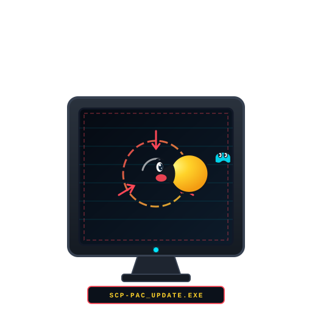<br/><sub>Scp Pac Update.Exe</sub></td><td align="center" width="110">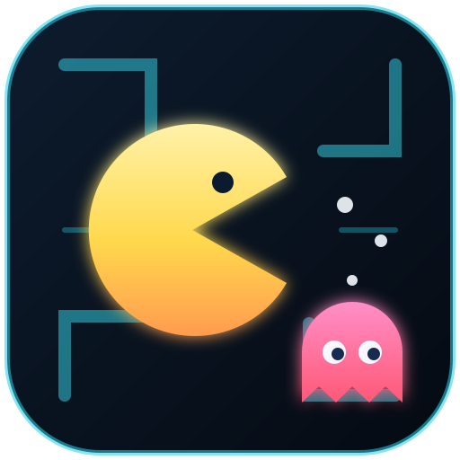<br/><sub>Neon Maze Icon</sub></td><td align="center" width="110">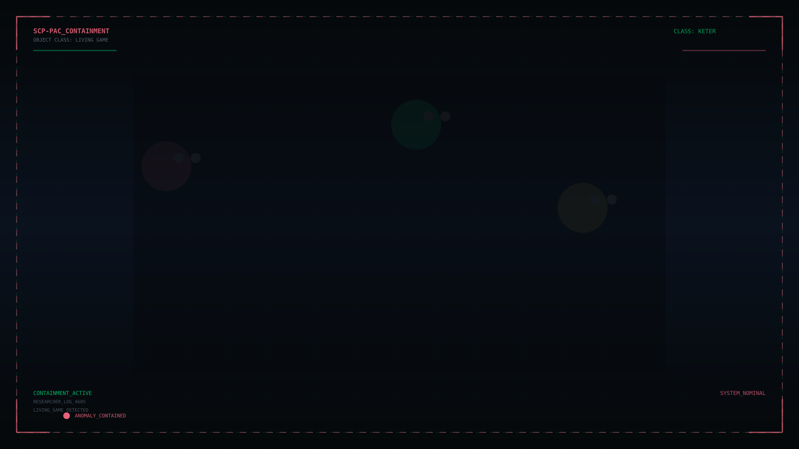<br/><sub>Scp Maze Background</sub></td><td align="center" width="110"><br/><sub>Ghost Coins</sub></td><td align="center" width="110"><br/><sub>Heart</sub></td><td align="center" width="110"><br/><sub>Hunger</sub></td></tr>
<tr><td align="center" width="110"><br/><sub>Paccoins</sub></td></tr>
</table>

### Character and animation atlases

<table>
<tr><td align="center" width="110"><br/><sub>Ability Effects Atlas</sub></td><td align="center" width="110"><br/><sub>Ghost Atlas</sub></td><td align="center" width="110">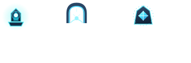<br/><sub>Maze Objects Atlas</sub></td><td align="center" width="110">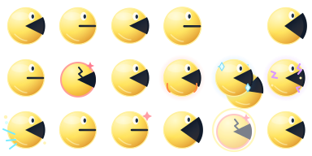<br/><sub>Runner Atlas</sub></td><td align="center" width="110">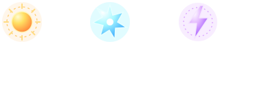<br/><sub>Special Pellets Atlas</sub></td><td align="center" width="110">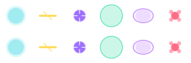<br/><sub>Ability Effects Atlas</sub></td></tr>
<tr><td align="center" width="110">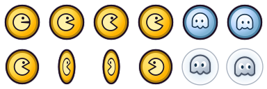<br/><sub>Coins Atlas</sub></td><td align="center" width="110">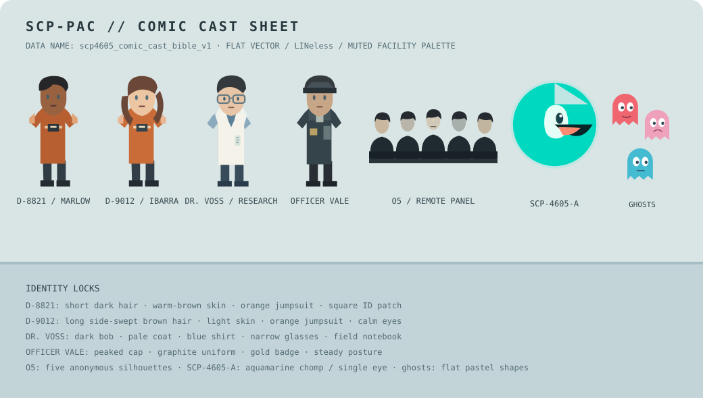<br/><sub>Comic Character Sheet</sub></td><td align="center" width="110">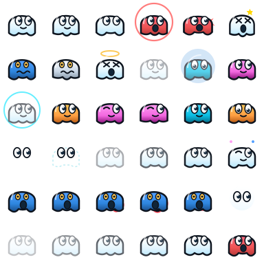<br/><sub>Ghost Atlas</sub></td><td align="center" width="110">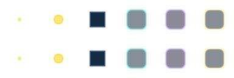<br/><sub>Maze Objects Atlas</sub></td><td align="center" width="110"><br/><sub>Pacmen Atlas</sub></td><td align="center" width="110">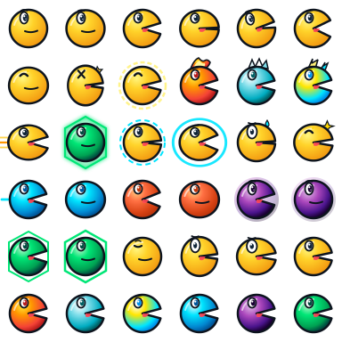<br/><sub>Runner Atlas</sub></td></tr>
<tr><td align="center" width="110">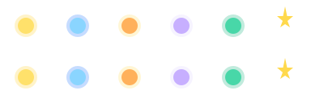<br/><sub>Special Pellets Atlas</sub></td></tr>
</table>

### Character portraits and currency

<table>
<tr><td align="center" width="110"><br/><sub>Ghost Coin</sub></td><td align="center" width="110"><br/><sub>Paccoin</sub></td><td align="center" width="110"><br/><sub>Silver Coin Ghost</sub></td><td align="center" width="110"><br/><sub>Ghost Blinky</sub></td><td align="center" width="110"><br/><sub>Ghost Clyde</sub></td><td align="center" width="110"><br/><sub>Ghost Inky</sub></td></tr>
<tr><td align="center" width="110"><br/><sub>Ghost Pinky</sub></td><td align="center" width="110"><br/><sub>Pacman Classic</sub></td><td align="center" width="110">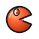<br/><sub>Pacman Crunch</sub></td><td align="center" width="110"><br/><sub>Pacman Phase</sub></td><td align="center" width="110"><br/><sub>Pacman Shield</sub></td><td align="center" width="110">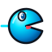<br/><sub>Pacman Speed</sub></td></tr>
</table>

### Abilities, equipment, and inventory

<table>
<tr><td align="center" width="110"><br/><sub>Ability Blink Step</sub></td><td align="center" width="110"><br/><sub>Ability Dread Wave</sub></td><td align="center" width="110"><br/><sub>Ability Echo Bolt</sub></td><td align="center" width="110"><br/><sub>Ability Frost Pop</sub></td><td align="center" width="110"><br/><sub>Ability Frost Ring</sub></td><td align="center" width="110"><br/><sub>Ability Hunger Siphon</sub></td></tr>
<tr><td align="center" width="110"><br/><sub>Ability Phase Crush</sub></td><td align="center" width="110"><br/><sub>Ability Phase Snap</sub></td><td align="center" width="110"><br/><sub>Ability Prism Barrage</sub></td><td align="center" width="110"><br/><sub>Ability Pulse Burst</sub></td><td align="center" width="110"><br/><sub>Ability Spark Pop</sub></td><td align="center" width="110"><br/><sub>Ability Star Lance</sub></td></tr>
<tr><td align="center" width="110"><br/><sub>Ability Sun Burst</sub></td><td align="center" width="110"><br/><sub>Ability Sunshot</sub></td><td align="center" width="110"><br/><sub>Ability Teleport</sub></td><td align="center" width="110"><br/><sub>Ability Time Field</sub></td><td align="center" width="110"><br/><sub>Ability Time</sub></td><td align="center" width="110"><br/><sub>Ability Veil Of Nothing</sub></td></tr>
<tr><td align="center" width="110"><br/><sub>Item Arc Cell</sub></td><td align="center" width="110"><br/><sub>Item Echo Dust</sub></td><td align="center" width="110"><br/><sub>Item Echo Pike</sub></td><td align="center" width="110"><br/><sub>Item Prism Bow</sub></td><td align="center" width="110"><br/><sub>Item Spark Sling</sub></td><td align="center" width="110"><br/><sub>Item Star Flake</sub></td></tr>
<tr><td align="center" width="110">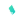<br/><sub>Item Wisp Fragment</sub></td><td align="center" width="110">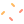<br/><sub>Weapon Chomper</sub></td><td align="center" width="110"><br/><sub>Weapon Echo Pike</sub></td><td align="center" width="110"><br/><sub>Weapon Prism Bow</sub></td><td align="center" width="110"><br/><sub>Weapon Spark Sling</sub></td></tr>
</table>

## Run locally

```sh
npm install
npm run dev
```

`npm run dev` starts Vite, the Socket.IO room/voice backend, and Electron. For the browser build use `npm run build`; to create the portable Windows app use `npm run build:windows`. Release files are written to the ignored `release/` directory.

Run the existing automated checks with `npm test`.

## Gameplay

- Select Pac-Men or Ghosts, name and customize the character, then choose story, training, or room play.
- Explore the connected, procedurally expanding maze, collect pellets and power orbs, fight local NPCs, earn XP/currency, and progress through quests and faction skills.
- Hearts, hunger, consumables, a four-slot hotbar, weapons, safe zones, and local saves support the survival-RPG layer.
- Animated SVG-derived characters, maze props, collectibles, abilities, and UI art are included in `assets/`.

## Controls

| Input | Action |
| --- | --- |
| WASD / arrow keys | Move; tap the same direction twice quickly to brake |
| Space / left click | Basic attack |
| R | Cast equipped faction ability |
| C | Pulse |
| Q | Dash as Pac-Men; phase-shift as Ghosts |
| T | Tame a nearby weakened ghost (Pac-Men only) |
| G | Talk to a nearby NPC |
| E / I / 4 | Open inventory |
| 1?3 | Use a hotbar item |
| F | Open/close room chat |
| P / Esc / Tab | Pause or toggle the in-game menu |

## Rooms and online limits

For LAN play, run the dev server on the host and let other players connect to the host's Vite address on port `5173`; share the same room code. Room relay and PeerJS voice signaling use ports `3100` and `9000` by default in development. Packaged desktop builds start local services and select nearby free ports; they support same-computer rooms. Internet rooms require a publicly hosted Node server, HTTPS/WSS, TURN for reliable voice, server-side gameplay validation, and moderation/privacy work. See [Microsoft Store and multiplayer hosting notes](docs/MICROSOFT_STORE.md).

Accounts, cloud saves, global rankings, authoritative PvP/economy, purchases, and a Steamworks integration are not implemented. See [ROADMAP.md](ROADMAP.md) for the current boundaries and next steps.

## Build notes

The Windows portable executable is unsigned unless a signing certificate is configured. Choose a repository license before inviting code reuse; without a `LICENSE` file, GitHub does not grant reuse rights. Do not publish credentials or local `.env` files.
